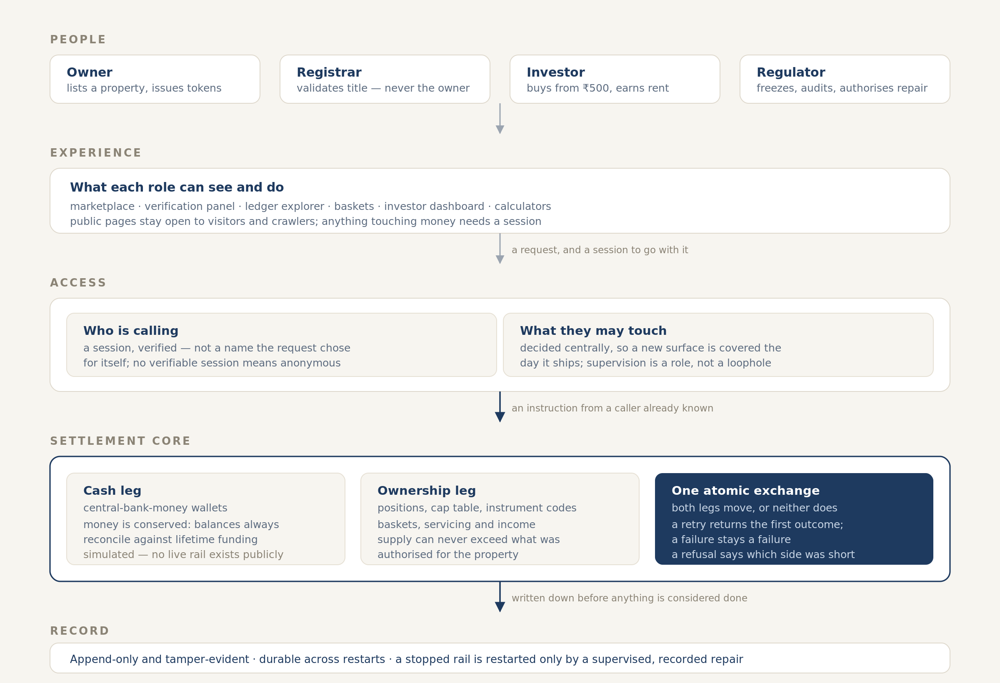

<div align="center">

# AasthiChain

### Own premium Indian real estate from ₹500

**Fractional property tokens on an append-only ledger · atomic delivery-versus-payment · UPI money leg**

[](https://github.com/katepallewarprathmesh-sketch/AasthiChain/actions/workflows/ci.yml)
[](https://aasthi-chain.vercel.app)
[](https://go.dev)
[](LICENSE)

[Live site](https://aasthi-chain.vercel.app) · [Ledger explorer](https://aasthi-chain.vercel.app/ledger) · [Settlement rail](https://aasthi-chain.vercel.app/umi) · [Calculators](https://aasthi-chain.vercel.app/tools) · [Learn](https://aasthi-chain.vercel.app/learn)

</div>

---

A premium flat costs ₹75 lakh and you cannot buy 0.1% of it. AasthiChain converts a registrar-verified
property into a fixed number of tokens (a ₹75 L villa becomes **15,000 tokens at ₹500**) and settles
the money leg and the ownership leg as one atomic operation. Both move, or neither does.

**Stack:** a Go settlement core, a Node API edge, a React frontend, and Hyperledger Fabric chaincode.

> **Honest scoping.** The settlement rail is a faithful **simulation**. There is no public UMI API and
> no live NPCI credential outside a bank partnership; real access is the SEBI Regulatory Sandbox.
> Every simulated surface is labelled as such in the UI and in API responses. What is real: the
> ledger, the atomicity, the verification rules and the guardrails. The exact line between the two
> is itemised at the end of this file.

**Contents**: [Quick start](#quick-start) · [How it fits together](#how-it-fits-together) · [Pages](#pages) · [What you can do](#what-you-can-do) · [Settlement rails](#settlement-rails) · [On a real Drunix network](#on-a-real-drunix-network) · [Guarantees](#guarantees) · [Testing](#testing)

Deeper reading: [Architecture and internals](docs/ARCHITECTURE.md) · [Testing](docs/TESTING.md) · [Audit](docs/REPOSITORY_AUDIT.md) · [Contributing](CONTRIBUTING.md)

---

## Quick start

**Prerequisites:** Go 1.25+, Node 20+, and `python3`. No credentials, no Docker, no database.

```bash
git clone https://github.com/katepallewarprathmesh-sketch/AasthiChain.git
cd AasthiChain
make dev
```

The app comes up on **http://localhost:8080**, the settlement core on `:21100`. Sign in as
`investor1` and buy a fraction of something. `make stop` stops what it started, `make help` lists
the rest.

Other demo identities: `originator1`, `registrar1`, `regulator1`, `investor2`.

```bash
curl localhost:8080/api/health       # the app
curl localhost:21100/health          # the settlement core
```

Running it another way, every configuration switch, and what each one does when absent:
[`docs/ARCHITECTURE.md`](docs/ARCHITECTURE.md). Deployment topology and failure modes:
[`docs/DEPLOYMENT.md`](docs/DEPLOYMENT.md).

---

## How it fits together

<div align="center">



</div>

<sub>Vector source: [`docs/architecture.svg`](docs/architecture.svg). Edit the SVG, then re-export the PNG (command in [`docs/DEPLOYMENT.md`](docs/DEPLOYMENT.md)).</sub>

Four kinds of people use it: owners list property, registrars validate title, investors buy and
trade fractions, regulators supervise. Behind them sit three things that matter.

**An access layer** decides who is calling and what they may touch, and keeps the property
register. **A settlement core** holds the cash leg and the ownership leg and moves them as one.
**An append-only record** sits underneath, and every other part answers to it.

One rule shapes the whole codebase: every rule about money lives in the settlement core, beside the
ledger it protects. Everything in front of it carries requests and identity and nothing else. A
money rule found anywhere else is a bug, and a pull request that adds one will be asked to move it.

The experience and the settlement core deploy independently, so either can be replaced, or fail,
without the other. When the core cannot be reached the app reports *unknown*. It never reports a
settlement surface as healthy because it could not ask.

Where each rule lives, the repository layout and the full configuration table:
[`docs/ARCHITECTURE.md`](docs/ARCHITECTURE.md).

---

## Pages

Everything is public to read except the five marked **session**. Search engines are
welcome on the public ones.

| Route | What it is |
|---|---|
| `/` · `/marketplace` · `/property/:id` | landing, the catalogue, and a single listing with its verification panel |
| `/market` | secondary market: holders trading tokens with each other |
| `/umi` | **the settlement rail.** DvP, e₹-W wallets, pilot ISINs, servicing, baskets, the work desk |
| `/ledger` | block explorer: every state change, replayable from the first block |
| `/verify` | hash your own copy of a deed and check it against the ledger, without uploading it |
| `/insights` | platform metrics; operator detail needs the key |
| `/dashboard` · `/wallet` | **session.** holdings, income, settlement history, e₹-W balance |
| `/admin` · `/admin/ops` | **session.** operator queues: what is waiting on a human |
| `/regulator` | **session.** supervisory view: halts, cap tables, reconciliation |
| `/learn` · `/tools` | index pages, plus three explainers and six calculators beneath them |
| `/trust` | every external boundary, and whether it is live or modelled locally |
| `/login` · `/about` · `/support` · `/privacy` · `/terms` | sign-in and the ordinary pages a real platform has |

---

## What you can do

**Buy a fraction.** Browse the marketplace, open a property, buy from ₹500. Payment and ownership
settle together: a buyer who cannot pay gets nothing and the seller keeps every token. Before money
moves, the app asks the rail whether the trade *would* settle, so a shortfall is a sentence rather
than a failure discovered afterwards.

**Check that a listing is real.** Every property page answers, in plain language: was title validated
by a registrar, and *who* (an owner validating their own listing is refused outright); is the deed
fingerprinted, and does it collide with another listing; does the ledger still replay cleanly. You
can prove your own copy of a deed matches the ledger without uploading anything: hash it locally and
paste the result.

**Ask the assistant.** A question box answers how things work and what is listed. It gets the same
public listing data a visitor can already see and nothing else: asked who holds what, it refuses and
points at the public ledger. Asked about a property that does not exist, it says so. It has no way to
move a token, a rupee or a document.

**Hold many properties as one unit.** A *basket* is a single tradeable unit backed by a fixed recipe
of several properties. Creating one moves the underlying tokens into custody, which is what makes the
unit redeemable rather than notional. A basket that is not fully backed is never allowed to look
healthy.

**Earn rent, split fairly.** Rent and coupons are paid straight into holders' wallets. The split can
follow a snapshot of who holds what today, or **how long each holder actually held**, so someone who
bought yesterday does not collect a full quarter's rent.

**Know the address is a real one.** When a property is listed, its pincode is checked against the
national postal directory and the answer is kept with the listing: confirmed, in a different place
from the one claimed, or not a pincode anybody posts to. The check is a courtesy and not a
gatekeeper, so an unreachable directory records that nothing was checked rather than inventing a
pass, and it never pretends to be proof of ownership. This is one of the few boundaries the platform
declares as genuinely live.

**Withdraw a listing and have it stay withdrawn.** A withdrawal is recorded against the property
rather than quietly dropped, so it survives a restart and holds across every view, and asking twice
is not an error. Anyone still holding tokens is bought out at the listed price first: the tokens
return to the owner and the payout is written to the ledger, because taking a listing off the market
must not strand the people who funded it.

**See the whole history.** Ownership is a journal of changes, not just a balance, so the register can
be replayed for any window.

---

## Settlement rails

### ASI, the Aasthi Settlement Interface

In September 2026 SEBI and RBI launched **Demat 2.0**: bonds issued as native tokens on the
depositories' permissioned DLT, with the **cash leg settled in wholesale CBDC (e₹-W)** through the
Unified Market Interface, with ₹1,025 crore issued by REC, L&T and IIFL. AasthiChain already had both
ends. This is the middle.

**ASI is our own rail, built to that pattern**, not a connection to the real UMI, which is reachable
only through a bank partnership or the SEBI sandbox. What follows is implemented here, end to end,
and can be run and audited from this repository.

- **Atomic DvP.** Both legs move or neither does; a failure leaves no half-settled state.
- **Central bank money is conserved.** Balances always reconcile against lifetime funding, so the rail
  can neither create money nor destroy it.
- **Programmable servicing.** Rent and coupons paid pro-rata on the due date, no registrar file
  exchange.
- **Safe retries.** A repeated settlement request returns the original outcome instead of settling
  twice, and a failure stays a failure.
- **Standards trace.** Every instruction carries the ISO 20022 message family a real
  securities-settlement rail would emit.

Refusals are always specific: which side was short, and by how much. Never a generic error.

### Work orders: upkeep paid on delivery

A tokenised building still has to be inspected, repaired and revalued, and that cost used to sit
outside the model: off-ledger, on trust, against an invoice nobody could audit. The fee is
**reserved** on the funder's e₹-W wallet when the order is funded (reserved money cannot be spent on
anything else, including a settlement), and moves to the worker in the same locked step that anchors
the deliverable's SHA-256 to the ledger. There is no state in which someone has been paid and no
evidence exists.

Only the funder pays out, only the assigned worker can deliver, and a dispute freezes the escrow
rather than deciding anything. Whoever supplies the worker sits behind an adapter, which runs as a
simulation: no external provider is integrated. Design notes:
[`docs/WORK_ORDERS.md`](docs/WORK_ORDERS.md).

## Anchored on a public blockchain

The settlement ledger here is permissioned, which is the right shape for settlement and also the
obvious objection: replaying it proves it agrees with itself, not that it is the history that
existed yesterday. So the head of the chain is published to a public blockchain as a digest, and
after that, rewriting history would mean rewriting a record on a network nobody here controls.

What crosses over is one line: the chain id, the block height, the block hash and the transaction
root. No participant, no asset, no amount. An anchor proves a digest existed at a time; it does not
claim the contents behind it are true, and the settlement data never leaves the service.

This part is not a simulation. The network calls are live, the transaction format is the real one,
and verification works for anyone with no account and no funds. Publishing costs a fee, so it stays
switched off, and says so, until a funded key is configured: [`docs/ANCHORING.md`](docs/ANCHORING.md).

## A model that was trained, not a rule sheet called AI

Payments are screened by hand-written rules: amount bands, velocity, a structuring window. Those
rules are honest and they are not machine learning, so they are no longer described as if they
were.

Alongside them runs a classifier that was actually fitted in this repository, on a labelled
dataset, with its coefficients committed and its accuracy measured on data it never saw rather
than asserted in a sentence. It held an AUC of 0.824 and caught about seven in ten of the
fraudulent payments in the held-out split, at roughly six in ten precision.

Two things about it are stated everywhere it appears. The training data is synthetic, because no
one hands a project like this real labelled fraud, so the score describes the generator and not
the world. And it is advisory: the published rules make the decision, the model is reported beside
them, and where the two disagree the disagreement is shown. Every score comes back with the
features that moved it: [`docs/RISK_MODEL.md`](docs/RISK_MODEL.md).

## Paying from outside India

Tokens are easy to send across a border; the consideration for Indian property is not. The law
requires it to arrive in rupees through banking channels, and a foreign national of non-Indian
origin resident outside India cannot buy here whatever they pay with. So the cross-border leg does
the only thing that is lawful: the stablecoin is received and converted outside India, and the
buyer's rupee wallet is credited only against an attestation that an inward remittance landed, with
a bank advice reference and a purpose code behind it. Eligibility and the transfer-information
rules are checked before a quote is given, and a refusal is recorded as plainly as an approval.

It is a simulation, labelled as one: no chain is connected, no custody is held and no money moves.
The screen for it is linked from the home page, and asking as a buyer who is not allowed to purchase
shows the refusal rather than hiding the option. The reasoning, the sources and what it deliberately
does not claim: [`docs/CROSS_BORDER.md`](docs/CROSS_BORDER.md).

### Money leg: UPI Collect

A payment is a lifecycle, not a hop: requested, approved, released, reconciled, with every amount held as
an exact figure, so no rupee is lost to arithmetic. The round-trip runs against a real provider's
test environment, so signed requests and callbacks are validated by the provider rather than graded
by us. Each payment is risk-screened before approval, and the screen explains its reasoning rather
than returning a score. No real money moves.

---

## On a real Drunix network

The settlement core runs in simulation by default, and the hosted demo is simulating. The chaincode,
though, has been deployed to a real NPCI Drunix network, which is NPCI's Hyperledger Fabric fork,
and written to.

On a two-organisation Drunix test network, a property registration submitted through the gateway
was endorsed by both organisations, ordered, and committed. The gateway reported the peer-assigned
transaction id and block number, and the committing peer, which runs none of this repository's
code, reported the same chain head independently.

Getting there took three fixes, and all three were invisible to a single-peer test. Two were real
defects in this chaincode: values that differed between endorsing peers, so no write could ever
agree with itself, and index entries in a format the network's state database rejects, which took
the peers down rather than the transaction. The third was in the test network's own tooling. Each
is now guarded by a test, and each is written up with its symptom, repro and fix in
[`docs/DRUNIX.md`](docs/DRUNIX.md) and [`docs/REPOSITORY_AUDIT.md`](docs/REPOSITORY_AUDIT.md).

What this claims: the chaincode and the gateway work against Drunix. What it does not: the hosted
demo is not connected to a Drunix network, `/trust` says so, and nothing here is an NPCI endorsement
or a pilot participation.

---

## Guarantees

**The record is append-only and survives restart.** An entry is written durably before the change it
describes is treated as real. Once written it is never erased, and each entry is sealed against the
one before it, so an altered history announces itself instead of passing quietly.

**Supply is scarce.** Tokens cannot exceed a property's authorised supply, and an owner's unsold
stock is never counted as allocated.

**Issuance cannot outrun stated backing.** Where somebody accountable has stated how much of an
asset exists, with evidence and a date it must be refreshed by, issuing past that figure is refused
and the refusal is written down. A statement past its refresh date stops authorising anything. The
platform checks the arithmetic, not whether the statement is true, and says so.

**Holder identity is private.** A visitor sees how many people hold a property and in what
proportions, under anonymous labels. Real names need a session, so the marketplace stays open to
browse without leaking a cap table.

**Approval is independent.** Title validation is restricted to a Registrar, and refused when the
validating identity registered the property.

**Your things answer only to you.** Being signed in is not being entitled: your wallet, payments,
holdings, documents and notifications are yours, and a stranger is refused even knowing the
reference. A regulator can look where that is genuinely the regulator's job, and nowhere else.

**A reference is not a key.** A bank reference on a receipt proves the payment happened. It reveals
nothing about who else was involved.

**A pause means paused.** A supervisor's halt is written down before the answer comes back, so it
survives a restart and applies to every route that could move those tokens. A longer way round is
not a way round. The same authority can lift it; both halt and lift are permanent record.

**Withdrawal does not strand a holder.** A listing cannot leave the market while someone still holds
it without that holder being bought out in the same step, and both the withdrawal and the payout are
permanent record.

**Nothing reaches the record around the rules.** Every ownership change passes the same approvals
whichever way it is attempted.

**A refusal is never a dead end.** If the record stops verifying, the platform stops rather than
building on history it cannot vouch for, and there is a supervised way back that writes down what
was set aside, why, and on whose authority. It has been used once, and the record of it is still
there to read.

---

## Testing

```bash
make dev          # the suites talk to a running stack, so start it first
make test         # the full sweep: 136 checks across 91 suite files
make test-go      # gofmt, vet and race tests across every Go module
make smoke        # every page renders real content
make secret-scan  # refuse tracked files that look like live credentials
```

A mass failure is almost always a dead rail rather than a bug, so check the core is up first. CI
runs the Go modules separately, builds the frontend, and treats formatting as a hard gate.

Some defects no suite here can reach: three were found only by deploying to a real two-org network,
and each now has a regression test. Exact commands, prerequisites, expected output and the
deliberate gaps: [`docs/TESTING.md`](docs/TESTING.md). A verified list of current weak points:
[`docs/REPOSITORY_AUDIT.md`](docs/REPOSITORY_AUDIT.md).

---

## Free tools and explainers

Single-purpose calculators, each a public page that stands on its own. All INR, Indian tax and
stamp-duty rules, no sign-up.

| Tool | What it answers |
|---|---|
| [Rental yield](https://aasthi-chain.vercel.app/tools/rental-yield-calculator) | gross vs net yield after maintenance, tax and vacancy |
| [Fractional investment](https://aasthi-chain.vercel.app/tools/fractional-investment-calculator) | what ₹X buys, and what it returns |
| [Stamp duty & registration](https://aasthi-chain.vercel.app/tools/stamp-duty-calculator) | state-wise duty on `max(price, circle rate)`, 1% TDS above ₹50 L |
| [Home loan EMI](https://aasthi-chain.vercel.app/tools/home-loan-emi-calculator) | EMI, amortisation, s.24(b) and 80C relief |
| [Rent vs buy](https://aasthi-chain.vercel.app/tools/rent-vs-buy-calculator) | the year the two curves cross |
| [Capital gains tax](https://aasthi-chain.vercel.app/tools/capital-gains-tax-calculator) | LTCG/STCG, the 23 Jul 2024 regime change, s.54 / 54EC / 54F |

Explainers: [Demat 2.0](https://aasthi-chain.vercel.app/learn/what-is-demat-2) ·
[Unified Market Interface](https://aasthi-chain.vercel.app/learn/what-is-umi) ·
[Atomic DvP](https://aasthi-chain.vercel.app/learn/what-is-atomic-dvp)

---

## Contributing

Issues and pull requests are welcome.

1. Fork, branch from `main`.
2. Keep money rules in the settlement core. A rule added to the edge will be asked to move.
3. Run `make test` and `make test-go` before opening a PR. `gofmt` is a hard gate in CI.
4. The API exists in two implementations that must stay in step; see [`docs/ARCHITECTURE.md`](docs/ARCHITECTURE.md).
5. New behaviour ships with a test that fails without it.

Commit messages are plain language describing the *why*, not a changelog of the diff.

The full guide, including the design rule that gets pull requests sent back and a list of genuine
starter tasks, is in [`CONTRIBUTING.md`](CONTRIBUTING.md). Participation is covered by
[`CODE_OF_CONDUCT.md`](CODE_OF_CONDUCT.md).

Found a security flaw? Please report it privately: see [`SECURITY.md`](SECURITY.md).

---

<details>
<summary><b>What is live vs simulated</b> (click to expand)</summary>

**Live and real:** the ownership rules and their duplicate-deed guard, the append-only record, atomic
settlement and its rollback, safe retries under concurrency, conservation of money, independent title
validation, verified sign-in, the supervisory halt and the way back from it, and durable storage. The
assistant is live, and its limits (public data only, no ability to act) are enforced on the server
rather than requested of the model.

**Simulated, and labelled as such:** the national payments rail (no live credentials exist outside a
bank partnership), the wholesale CBDC wallets (e₹-W is an RBI pilot, not a public API), the UMI rail
itself (real access is the SEBI Regulatory Sandbox), government-issued KYC, the land-record lookup,
and the public-chain escrow experiment.

**The payment round-trip is genuinely real** as far as it goes: the provider's test environment
accepts our signed requests, and tampered amounts and bad signatures are rejected by them, not by us.
Only the settlement behind it is simulated.

</details>

<details>
<summary><b>Regulatory context</b> (click to expand)</summary>

The **Asset Tokenisation (Regulation) Bill 2026** is a pending Private Member's Bill, not law. It
proposes KYC/AML obligations, a registered custodian, registrar validation and a regulator freeze
power. AasthiChain maps to all four: a Registrar org validates title, a Regulator org can freeze, the
cap table is auditable end to end, and the payment path enforces a KYC gate.

**SPV structure.** Real platforms wrap each property in a special-purpose vehicle, so a token is a
beneficial interest in the SPV holding legal title (Registration Act 1908 + the 2026 Bill). That is a
legal structure, not a code change, and is documented as Phase 2 rather than built.

</details>

---

## Support

The in-app [Support page](https://aasthi-chain.vercel.app/support) carries UPI and GitHub Sponsors
links. These are **donations to the project, not investments**. They buy no tokens and no stake.

<div align="center">

**[aasthi-chain.vercel.app](https://aasthi-chain.vercel.app)** · [Apache 2.0 licensed](LICENSE)

</div>
